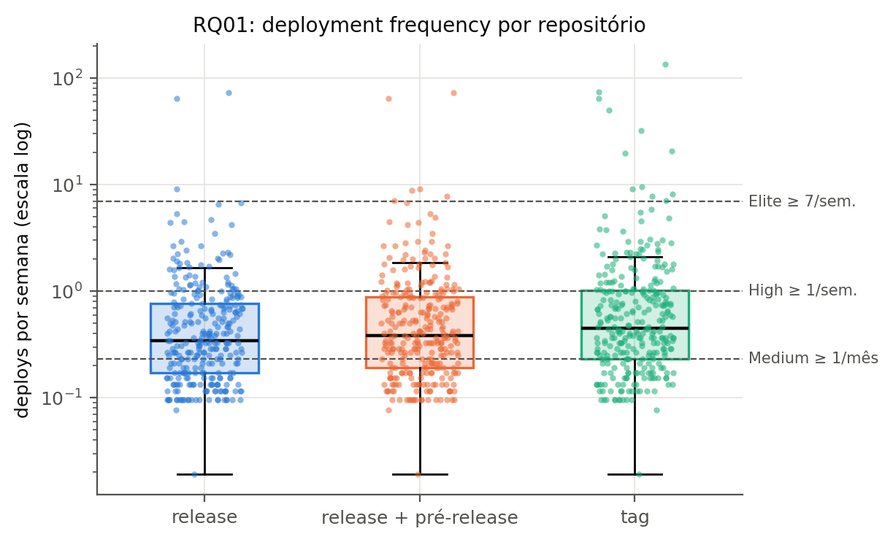
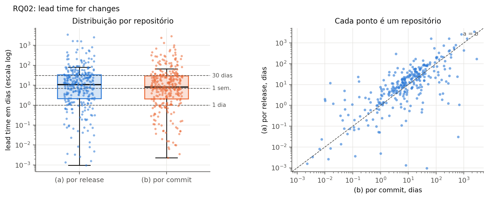
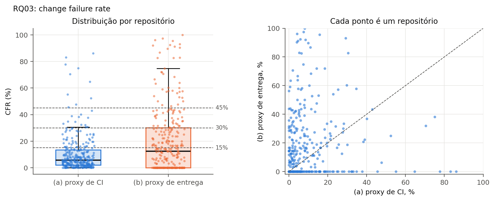
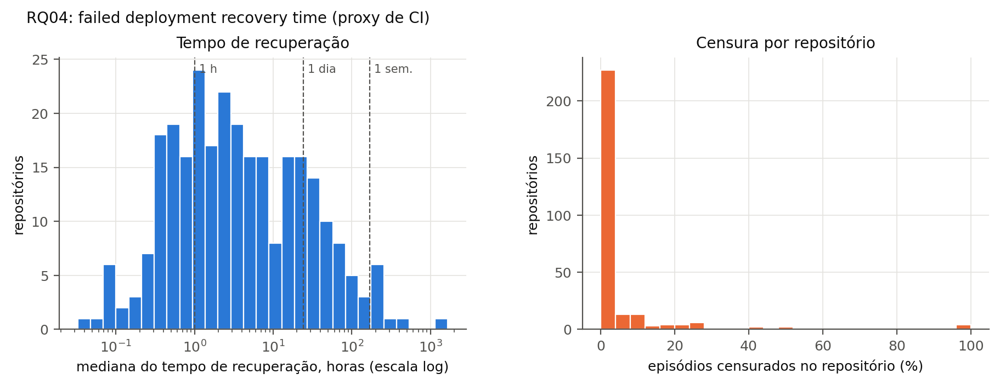
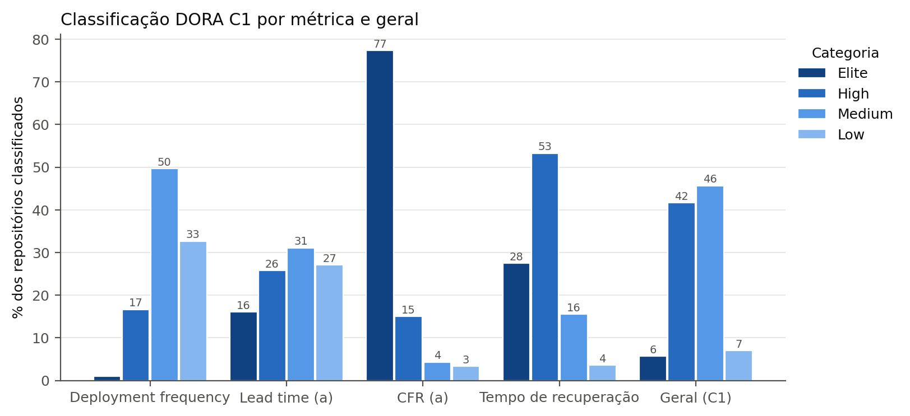
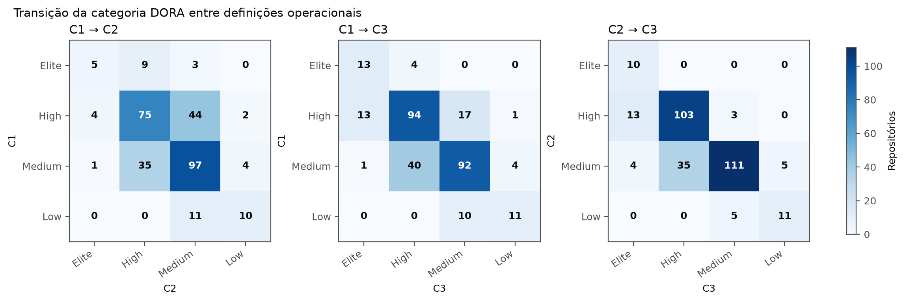

# Minerando métricas DORA em repositórios open-source: o quanto podemos confiar nos *proxies*?

**Luisa Clara de Paula Lara Silva, Matheus Gaston, Mirelly Alvarenga**

Curso de Engenharia de Software — Laboratório de Experimentação de Software

> Versão em Markdown do artigo (template SBC, Overleaf). Introdução e hipóteses
> registradas em **07/10/2026, antes da coleta e da análise dos dados** (Issue #53).
> A versão LaTeX está em [`artigo/introducao_hipoteses_2026-10-07.tex`](artigo/introducao_hipoteses_2026-10-07.tex).

**Resumo.** *A ser escrito na entrega final, depois dos resultados.*

# 1. Introdução

As métricas DORA (*DevOps Research and Assessment*) tornaram-se a referência
mais usada para medir o desempenho de entrega de software. Popularizadas por
[@forsgren2018] e revisadas anualmente pelos relatórios *Accelerate State of
DevOps*, elas descrevem a entrega em duas dimensões: **velocidade**, medida
pela frequência de *deploy* e pelo *lead time* das mudanças, e
**estabilidade**, medida pela taxa de falha das mudanças (*change failure
rate*, CFR) e pelo tempo de recuperação após um *deploy* que falhou
[@dora2024]. Em 2024 o DORA acrescentou uma quinta métrica, a *deployment
rework rate*, que mede a proporção de *deploys* não planejados feitos para
corrigir problemas. Uma das afirmações centrais desse corpo de pesquisa é que
velocidade e estabilidade não competem entre si: as equipes de melhor
desempenho seriam rápidas *e* estáveis ao mesmo tempo.

Nas organizações, essas métricas costumam ser obtidas de ferramentas internas
que registram cada *deploy* em produção e cada incidente. Em projetos
open-source isso não existe. O GitHub não registra "*deploys* em produção"
nem "falhas em produção"; ele registra *releases*, *tags*, *commits* e
execuções de *workflows* de integração contínua (CI). Quem quiser calcular
métricas DORA a partir desses dados precisa usar ***proxies***, isto é,
medidas indiretas no lugar das que não podem ser observadas. Neste trabalho,
uma *release* publicada faz o papel de *deploy* e uma execução de CI que
falhou faz o papel de falha.

Esses *proxies* têm limitações conhecidas. Primeiro, **release não é
deploy**: uma biblioteca que publica uma versão por mês não coloca nada em
produção; quem faz isso são os projetos que a utilizam, cada um no seu ritmo.
Segundo, **CI não é produção**: uma execução de *pipeline* que falha no
branch principal indica um teste quebrado, um problema de infraestrutura ou
um teste instável (*flaky*), e não necessariamente um defeito percebido pelo
usuário. Terceiro, as datas disponíveis são imperfeitas: *rebase* e *squash
merge* reescrevem a data dos *commits* e distorcem o *lead time*. Por isso, o
valor de uma métrica DORA minerada depende da definição operacional
escolhida, e duas definições igualmente razoáveis podem levar a conclusões
diferentes sobre o mesmo repositório.

O **objetivo** deste estudo é minerar as métricas DORA de repositórios
open-source populares que usam GitHub Actions, numa janela de observação de
12 meses (30/09/2025 a 30/09/2026), e avaliar o quanto esses valores são
confiáveis. Além de calcular as métricas, (i) validamos o critério automático
de *release* corretiva contra uma amostra rotulada manualmente por três
avaliadores e (ii) medimos o quanto a classificação DORA de cada repositório
muda quando a definição operacional muda. O estudo é guiado pelas seguintes
questões de pesquisa (RQs):

- **RQ01.** Qual a frequência de *deploys* dos repositórios populares que usam CI/CD?
- **RQ02.** Qual o tempo entre um *commit* e seu respectivo *deploy*?
- **RQ03.** Qual a taxa de falha das mudanças entregues por esses repositórios?
- **RQ04.** Qual o tempo de recuperação após uma execução de CI/CD com falha?
- **RQ05.** Repositórios com maior frequência de *deploy* apresentam maior ou menor taxa de falha?
- **RQ06.** Quais características dos repositórios estão associadas a um melhor desempenho DORA?
- **RQ07.** O quanto a classificação DORA de um repositório depende da definição operacional escolhida?
- **RQ08 (bônus).** Qual a *rework rate* dos repositórios e em que ela difere do CFR baseado em *releases*?

## 1.1 Hipóteses informais

As hipóteses abaixo foram registradas em 07/10/2026, antes da coleta e da
análise dos dados, e expressam o que o grupo *espera* encontrar. A Seção de
Discussão as confronta com os resultados. As categorias citadas (Elite, High,
Medium, Low) seguem a tabela de referência da disciplina.

**H1 (RQ01, frequência de *deploy*).** Esperamos uma mediana entre uma
*release* por mês e uma por semana (categoria Medium), com distribuição muito
assimétrica à direita. A maior parte dos projetos populares é biblioteca ou
*framework* e agrupa mudanças em versões planejadas; só uma cauda pequena, com
publicação automatizada a cada *merge* (*nightly builds* ou ferramentas como
*semantic-release*), deve chegar a Elite.

**H2 (RQ02, *lead time*).** Esperamos *lead times* da ordem de semanas, com a
variante (a), por *release*, sistematicamente maior que a variante (b), por
*commit*, em praticamente todos os repositórios. A variante (a) é determinada
pelo *commit* mais antigo incluído na *release*, e basta um *commit*
"esquecido" para inflá-la; a (b) é dominada pela massa de *commits* feitos
pouco antes da publicação. Assim, a variante (a) deve situar a maioria dos
repositórios em Medium ou Low, e a (b), em High ou Medium.

**H3 (RQ03, taxa de falha).** Esperamos CFR (a), o *proxy* de CI, com mediana
entre 10% e 25%. As execuções consideradas são as de *push* no branch
principal, e boa parte das mudanças já passou pelos *checks* do *pull
request* antes do *merge*; ainda assim, testes instáveis e falhas de
infraestrutura mantêm a taxa acima de zero. Para o CFR (b), o *proxy* de
entrega, esperamos valores de mesma ordem, mas pouco correlacionados com o
CFR (a), porque as duas variantes medem fenômenos diferentes: quebra de
*pipeline* e correção rápida de uma versão publicada.

**H4 (RQ04, tempo de recuperação).** Esperamos mediana de algumas horas
(categoria High). Em projetos ativos, uma falha no branch principal costuma
ser corrigida pelo *commit* seguinte ou resolvida reexecutando o *workflow*.
Esperamos também uma cauda longa e uma proporção não desprezível de episódios
censurados, vindos de *workflows* secundários (documentação, *lint*,
*benchmarks*) que permanecem quebrados por semanas sem bloquear o
desenvolvimento.

**H5 (RQ05, velocidade × estabilidade).** Para o CFR (a), esperamos
correlação de Spearman fraca ou nula (|ρ| < 0,3), o que seria compatível com
a afirmação do DORA de que velocidade e estabilidade não são um *trade-off*.
Para o CFR (b), esperamos correlação positiva, mas por um artefato da
definição: quem publica *releases* com muita frequência tem mais chance de ter
qualquer *release* seguida, em até 7 dias, por outra que só muda o *patch*,
mesmo que nenhuma delas corrija um defeito.

**H6 (RQ06, fatores associados ao desempenho).** Esperamos que o número de
contribuidores esteja associado a maior frequência de *deploy* e a menor
tempo de recuperação, porque mais pessoas produzem mais mudanças e reagem
mais rápido a quebras. Esperamos também diferenças por linguagem, com
ecossistemas de publicação automatizada (JavaScript/TypeScript, Go e Rust)
publicando com mais frequência, e repositórios mais antigos com processos de
*release* mais lentos e cerimoniosos. Mesmo quando as diferenças forem
significativas após a correção de Holm, esperamos tamanhos de efeito pequenos
(ε² < 0,06), já que nenhum fator isolado deve explicar muito da variação.

**H7 (RQ07, sensibilidade às definições).** Esperamos que a classificação
DORA seja sensível à definição operacional: pelo menos 30% dos repositórios
devem mudar de categoria em algum par de combinações, com kappa de Cohen
ponderado apenas moderado (entre 0,4 e 0,6). A troca mais instável deve ser a
que usa *tags* como unidade de *deploy*, pois muitos projetos criam *tags*
sem publicar *release*, o que altera a frequência e, por consequência, o
*lead time*.

**H8 (RQ08, *rework rate*).** Esperamos *rework rate* maior que o CFR (b), na
faixa de 20% a 35% das *releases*. A *rework rate* conta todas as *releases*
corretivas, inclusive as publicadas mais de 7 dias depois da versão que
corrigem e as que corrigem outra *release* corretiva; o CFR (b) só conta a
*release* original quando a correção chega dentro da janela de 7 dias.

O restante do artigo está organizado da seguinte forma: a Seção 2 descreve a
metodologia (fonte de dados, funil de seleção, definições operacionais e
validação manual); a Seção 3 apresenta os resultados por RQ; a Seção 4
discute os resultados frente às hipóteses; a Seção 5 trata das ameaças à
validade; e a Seção 6 relata a replicação cruzada do estudo.

# 2. Metodologia

O estudo é uma mineração de repositórios (*mining software repositories*)
sobre dados públicos do GitHub. Todas as etapas, da busca de candidatos ao
cálculo das métricas, são feitas por scripts do grupo em `lab03/code`, que
acessam diretamente a API REST do GitHub, sem bibliotecas de terceiros para
a API. Os parâmetros (janela, semente, critérios de inclusão, tamanho da
amostra) ficam em `config.yaml`, e qualquer pessoa pode regenerar os mesmos
arquivos com `python -m pipeline --config config.yaml`.

## 2.1 Fonte de dados e janela de observação

A janela de observação é o intervalo semiaberto **[30/09/2025, 30/09/2026)**,
com 365 dias (≈ 52,1 semanas), fixado pelo professor para toda a turma. Só
entram nas métricas *releases* publicadas e execuções de *workflow* criadas
dentro dela. Os dados vêm de seis *endpoints*: busca de repositórios
(`/search/repositories`), *workflows* (`/actions/workflows`), execuções de
*workflow* (`/actions/runs`), *releases* (`/releases`), *tags* (`/tags`) e
comparação entre duas *tags* (`/compare/{base}...{head}`), além de
`/contributors` para contar contribuidores.

Três limites da API exigem cuidado. (i) A busca devolve no máximo 1.000
resultados por consulta; por isso ela é fatiada por faixas de estrelas, e
toda faixa acima do teto é dividida ao meio até caber nele (no extremo, uma
única contagem de estrelas é fatiada pela data de criação). (ii) A listagem
de execuções filtrada também para em 1.000 resultados; o pipeline sonda o
total de cada intervalo e o subdivide (até o nível de um dia) quando o teto é
atingido. (iii) O `compare` sem paginação para em 250 *commits*; o pipeline
pagina de 100 em 100 seguindo o cabeçalho `Link`. Todas as respostas são
guardadas num cache SQLite, o que permite retomar a coleta após quedas de rede
ou pausas por *rate limit*, e as pausas seguem os cabeçalhos
`X-RateLimit-Remaining` e `X-RateLimit-Reset`.

## 2.2 Seleção da amostra

Os candidatos são todos os repositórios com mais de 1.000 estrelas
(`stars:>1000`), sem duplicatas. Eles são embaralhados com semente fixa
(`seed = 42`) e avaliados nessa ordem até que a amostra atinja o tamanho-alvo.
Cada candidato passa pelos filtros em ordem crescente de custo, parando no
primeiro que reprova: (1) não arquivado; (2) não *fork*; (3) usa GitHub
Actions (`total_count > 0` em `/actions/workflows`); (4) pelo menos 5
*releases* publicadas na janela; (5) pelo menos 50 execuções válidas
(sucesso ou falha) de `push` no *default branch* na janela. Os dois últimos
são o critério mínimo de inclusão comum à turma. Embaralhar antes de avaliar
evita que a amostra fique concentrada nos repositórios mais populares.

A Tabela 1 mostra o funil gerado automaticamente pelo pipeline
(`data/funil.csv`) para a amostra da Sprint 01; a coleta completa da Sprint 02
(Issue #63) estende a mesma ordem de avaliação até pelo menos 300
repositórios.

**Tabela 1. Funil de seleção da amostra da Sprint 01 (busca em 14/10/2026).**

| Etapa | Restam | Descartados | Motivo |
|---|---:|---:|---|
| Candidatos da busca (`stars:>1000`, sem duplicatas) | 65.532 | – | – |
| Avaliados em ordem aleatória até reunir a amostra | 855 | 64.677 | não avaliados: amostra completa |
| Não arquivados | 786 | 69 | arquivado |
| Não *fork* | 786 | 0 | *fork* |
| Disponíveis na API | 786 | 0 | erro ou acesso negado |
| Com GitHub Actions | 464 | 322 | `total_count = 0` |
| ≥ 5 *releases* na janela | 137 | 327 | poucas *releases* |
| ≥ 50 execuções válidas na janela | **100** | 37 | poucas execuções |

A busca foi dividida em 96 faixas de estrelas, nenhuma acima do teto de
1.000 resultados (a maior tem 989). Entre os candidatos avaliados, o filtro
que mais descarta é o de *releases*: só 30% dos repositórios com GitHub
Actions publicaram pelo menos 5 *releases* na janela, o que já indica que
publicar *releases* no GitHub não é a prática da maioria dos projetos
populares. Na amostra de 100 repositórios, a mediana é de 3.604 estrelas,
99 contribuidores, 6,7 anos de idade, 16,5 *releases* e 516 execuções
válidas na janela; as linguagens mais frequentes são TypeScript (21),
Python (21), Go (15) e Rust (9).

## 2.3 Metadados dos repositórios

Para cada repositório da amostra, o pipeline registra (`data/metadados.csv`):
estrelas, linguagem principal, data de criação e idade no fim da janela (em
dias), *default branch*, número de *workflows*, número de *releases* e
pré-*releases* na janela, número de execuções válidas na janela e número de
contribuidores. Os contribuidores são contados com uma única chamada a
`/contributors?per_page=1&anon=true`, lendo o número da última página no
cabeçalho `Link`. Esses metadados e o tipo do projeto rotulado manualmente
(Seção 2.6) são os fatores da RQ06; fatores numéricos são agrupados por
quartis.

## 2.4 Definições operacionais

As definições abaixo são comuns a toda a turma, para que os resultados sejam
comparáveis e o estudo possa ser replicado por outro grupo.

- **Deploy:** uma *release* publicada (`draft = false`, `prerelease = false`)
  com `published_at` na janela. Pré-*releases* e *tags* sem *release* só
  entram como variantes na RQ07.
- **Branch:** apenas o *default branch* do repositório.
- **Data de um commit:** `commit.author.date`.
- **Execuções de CI:** apenas execuções disparadas por `push` (`event = push`)
  no *default branch*. O campo `conclusion` define a classificação: `success`
  é sucesso; `failure`, `timed_out` e `startup_failure` são falha; os demais
  valores (`cancelled`, `skipped`, `neutral`, `action_required`, `stale` e
  vazio) são ignorados.
- **Censura:** um evento que não termina dentro da janela (um episódio de
  falha ainda não recuperado, uma *release* dos últimos 7 dias cuja correção
  ainda não poderia ter saído) não é descartado; é contado como censurado e
  reportado.

## 2.5 Métricas

Em todas as RQs, cada métrica é calculada por repositório e resumida na
amostra por **mediana e IQR**, por causa da assimetria típica dessas
distribuições.

- **RQ01, frequência de deploy:** nº de *releases* na janela ÷ nº de semanas
  da janela (≈ 52,1), em *releases* por semana.
- **RQ02, lead time:** para cada *release* R da janela, os *commits* de R são
  os de `compare/{release anterior}...{R}`; a *release* anterior pode estar
  fora da janela. *Releases* sem anterior (a primeira da história) ou com
  *tags* apagadas (`compare` com 404) ficam fora do cálculo e são contadas.
  **(a) Por release:** `published_at(R) − data do commit mais antigo de R`,
  com a mediana entre as *releases*. **(b) Por commit:**
  `published_at(R) − data de cada commit de R`, com a mediana de todos os
  *commits* de todas as *releases*.
- **RQ03, taxa de falha (CFR):** **(a) proxy de CI:**
  `falhas ÷ (falhas + sucessos)` entre as execuções válidas. **(b) proxy de
  entrega:** as *releases* publicadas da janela são ordenadas por
  `published_at`; uma *release* R falha se alguma *release* publicada depois
  dela, no intervalo `(published_at(R), published_at(R) + 7 dias]`, for
  corretiva (Seção 2.7), e não só a imediatamente seguinte. CFR = *releases*
  que falharam ÷ *releases* avaliadas. As *releases* dos últimos 7 dias da
  janela (`published_at ≥ 23/09/2026`) não têm o prazo inteiro observado:
  saem do numerador e do denominador (censura) e são reportadas, mas ainda
  podem marcar como falha uma *release* anterior. O CFR (b) é indefinido
  quando todas as *releases* do repositório são censuradas.
- **RQ04, tempo de recuperação:** as execuções de cada *workflow* são
  ordenadas por `run_started_at`; um episódio de falha começa na primeira
  falha após um sucesso e termina no próximo sucesso do mesmo *workflow*. A
  duração é `updated_at do sucesso − run_started_at da primeira falha`, em
  horas, com a mediana de todos os episódios do repositório. Episódios sem
  sucesso até o fim da janela são censurados, e a proporção de censurados é
  reportada.
- **RQ05:** correlação de Spearman (ρ, p-valor e n) entre a frequência de
  *deploy* e o CFR, separadamente para as variantes (a) e (b).
- **RQ06:** Kruskal-Wallis (ou Mann-Whitney, com dois grupos) para cada par
  fator × métrica, com correção de Holm para comparações múltiplas e tamanho
  de efeito (ε² = H/(n − 1) ou *Cliff's delta*).
- **RQ07:** cada repositório é classificado em Elite, High, Medium ou Low em
  cada métrica pela tabela de referência da disciplina, e a categoria geral é
  a mediana das notas (Elite = 4, …, Low = 1) arredondada para baixo. A
  classificação é repetida em três combinações de definições: **C1**
  (*release*, *lead time* (a), CFR (a)), **C2** (*release* + pré-*release*,
  *lead time* (b), CFR (b)) e **C3** (*tag*, *lead time* (b), CFR (a)). Para
  cada par de combinações, reportamos a proporção de repositórios que mudam de
  categoria e o kappa de Cohen ponderado linearmente.
- **RQ08 (bônus):** *rework rate* = *releases* corretivas ÷ total de
  *releases* na janela, usando a mesma heurística do CFR (b) (sem censura,
  pois não depende do que vem depois da *release*).

## 2.6 Validação manual (amostra-ouro)

Para saber o quanto os critérios automáticos concordam com o julgamento
humano, os três autores rotularam uma amostra-ouro. O protocolo completo está
em `docs/protocolo_consenso.md` e o guia de rotulagem em
`validacao/guia_rotulagem.md`.

**Sorteio.** O script `rotulagem/sorteio.py` sorteia 60 repositórios
(`sample(n=60, random_state=42)`) entre os 100 primeiros incluídos na ordem
de avaliação da Seção 2.2, e 5 *releases* publicadas na janela de cada um
(`random_state=42`), num total de 300 *releases*. Como a ordem de avaliação é
fixa, esses 100 repositórios continuam sendo os primeiros incluídos quando a
amostra cresce, e rodar o script de novo gera exatamente o mesmo sorteio. A
planilha de rotulagem traz, para cada *release*, o link da sua página e o
link da comparação com a *release* anterior, e não traz nenhuma coluna da
heurística.

**Rotulagem independente.** Cada autor, sem consultar os demais e sem ver a
saída da heurística, rotulou: (i) o tipo do projeto (biblioteca/*framework*,
aplicação/serviço, ferramenta CLI ou outro); (ii) se as *releases* do
repositório representam entregas reais ao usuário (sim, não ou incerto); e
(iii) para cada uma das 5 *releases*, se ela é corretiva (sim ou não), lendo
as *release notes* e os *commits*. Cada planilha foi commitada antes da
reunião de consenso, e a data do commit registra a independência.

**Concordância.** A concordância entre os três avaliadores é medida pelo
kappa de Fleiss (`aggregate_raters` e `fleiss_kappa` do `statsmodels`) em
cada dimensão: 60 itens no tipo do projeto e nas entregas reais e 300 itens
na *release* corretiva. Os valores são interpretados pela escala de Landis e
Koch (1977) e calculados sobre as planilhas independentes, antes da reunião.

**Consenso.** Itens unânimes ou com maioria de 2 votos recebem o rótulo da
maioria; empates 1-1-1, possíveis nas dimensões com mais de duas categorias,
são decididos em reunião, e cada decisão fica registrada com a sua
justificativa em `validacao/decisoes_reuniao.csv`. O resultado,
`validacao/rotulos_consenso.csv`, é a referência para avaliar a heurística de
*release* corretiva com precisão, *recall* e F1 (refinando-a enquanto o F1
ficar abaixo de 0,70) e fornece o tipo do projeto usado na RQ06.

## 2.7 Heurística de *release* corretiva

Uma *release* corretiva é aquela cujo objetivo principal é corrigir um
defeito recente. A heurística (`metrics/corretiva.py`) só usa dados que o
pipeline já coleta: o nome da *tag* da *release* R e o da *release* anterior,
a primeira linha das mensagens dos *commits* de
`compare/{anterior}...{R}` e o texto das *release notes* (campo `body` da
própria listagem de *releases*, sem chamadas extras à API). A versão SemVer é
o último trecho `X.Y` ou `X.Y.Z` da *tag*, o que aceita prefixos de pacote
(`rig-core-v0.1.2`, `@scope/pacote@1.2.3`) e sufixos (`-rc.1`, `.Final`);
*tags* sem esse trecho (`unlshd-083`, `october-2025`) são tratadas como fora
do SemVer, sem erro. Três versões foram avaliadas (histórico completo em
`docs/versoes_heuristica.md`):

- **v1 (enunciado):** R é corretiva se a versão muda só o *patch* em relação
  à anterior (`2.3.0 → 2.3.1`) **ou** se algum *commit* contém `revert`,
  `hotfix` ou `fix` no início de uma palavra.
- **v2 (só *commits*):** descarta linhas de ruído (*commits* `chore`, `ci`,
  `docs`, `build`, `test`, `refactor`, *merges*, *bumps* de dependência,
  *commits* de versão e o texto padrão das notas do GitHub) e compara versões
  só entre *tags* do mesmo pacote (o prefixo antes da versão). R é corretiva
  se: (i) a versão muda só o *patch* ou está fora do SemVer; (ii) tem no
  máximo 5 *commits* significativos; e (iii) há pelo menos um sinal de
  correção (`fix`, `hotfix`, `revert`, `bug`, `regression`, `crash`,
  `broken`, `workaround`) e no máximo 0,5 sinal de funcionalidade (`feat`,
  `add`, `new`, `implement`, `support`, `improve`…) por sinal de correção.
- **v3 (*commits* + *release notes*, versão final):** como a v2, mas os sinais
  de (iii) são contados também nas linhas das *release notes*, e a mudança
  de *minor* é aceita (só a de *major* fica de fora), porque alguns projetos
  sobem o *minor* mesmo em *releases* só de correção.

Os limiares da v2 e da v3 (5 *commits*, 0,5 funcionalidade por correção,
incrementos aceitos) foram escolhidos numa grade pequena de valores e
avaliados por validação cruzada agrupada por repositório (5 partes), para
estimar o desempenho em repositórios fora da amostra-ouro. Precisão,
*recall* e F1 são calculados com `precision_recall_fscore_support`
(`rotulagem/avaliacao.py`), tendo "corretiva = sim" do consenso como classe
positiva.

## 2.8 Conferência da coleta

Além dos testes unitários (cobertura mínima de 80% nas funções de métrica,
verificada na integração contínua do repositório), o script `conferencia.py`
recalcula, por um caminho independente e sem cache, o número de *releases* e
de execuções válidas de dois repositórios da amostra (o de menos e o de mais
execuções) e compara com o pipeline. As execuções são contadas pelo
`total_count` filtrado por `status`, mês a mês, em vez de baixar e
classificar cada execução. O resultado fica em `data/conferencia.md`, com os
links para conferir os valores na interface do GitHub.

# 3. Resultados

A amostra final tem 300 repositórios (funil em `data/funil.csv`). Releases,
*commits* e execuções foram coletados entre 18 e 19/10/2026 para a mesma
amostra selecionada em 14/10 (`--reusar-amostra`): 17.859 *releases*
publicadas na janela, 1.361.066 *commits* e 555.301 execuções, das quais
491.249 válidas. Entre a seleção e a coleta, os totais caíram 0,5%
(*releases*) e 0,6% (execuções válidas), porque *releases* foram apagadas e
execuções expiraram pela retenção do GitHub; dois repositórios ficaram abaixo
de 5 *releases* e foram mantidos. Os números desta seção vêm de
`code/data/dataset_dora.csv` e do notebook `analise/rq01_04_descritiva.ipynb`
(Issue #64); a Tabela 2 resume todas as métricas e variantes.

**Tabela 2. Mediana e IQR das métricas DORA por repositório (n = repositórios com a métrica definida).**

| RQ | Métrica (variante) | Unidade | n | Mediana | Q1 | Q3 | IQR |
|---|---|---|---:|---:|---:|---:|---:|
| RQ01 | Frequência (*release*) | por semana | 300 | 0,35 | 0,17 | 0,77 | 0,59 |
| RQ01 | Frequência (*release* + pré-*release*) | por semana | 300 | 0,38 | 0,19 | 0,88 | 0,69 |
| RQ01 | Frequência (*tag*) | por semana | 300 | 0,45 | 0,23 | 1,02 | 0,79 |
| RQ02 | *Lead time* (a) por *release* | dias | 299 | 10,6 | 2,2 | 33,3 | 31,1 |
| RQ02 | *Lead time* (b) por *commit* | dias | 299 | 8,1 | 2,0 | 29,6 | 27,5 |
| RQ03 | CFR (a) *proxy* de CI | % | 300 | 5,7 | 2,0 | 13,5 | 11,5 |
| RQ03 | CFR (b) *proxy* de entrega | % | 300 | 12,5 | 0,0 | 30,2 | 30,2 |
| RQ04 | Tempo de recuperação | horas | 276 | 3,1 | 0,9 | 17,4 | 16,5 |

## 3.1 RQ01: frequência de *deploy*

A mediana é de 0,35 *release* por semana, cerca de uma *release* a cada três
semanas (Figura 1). Metade dos repositórios (49,7%) publica entre uma por mês
e uma por semana (Medium), 32,7% publicam menos de uma por mês (Low), 16,7%
entre uma e sete por semana (High) e só três (1,0%) chegam a Elite. A
distribuição é muito assimétrica: o máximo é de 73 *releases* por semana,
enquanto o Q3 é de 0,77. Contar pré-*releases* ou *tags* desloca a mediana
para 0,38 e 0,45 por semana, respectivamente, porque muitos projetos criam
*tags* sem publicar *release*.

**Figura 1. Frequência de *deploy* por repositório nas três unidades de *deploy* (escala log); as linhas marcam os cortes da tabela DORA.**

## 3.2 RQ02: *lead time*

O *lead time* mediano é de 10,6 dias na variante (a) e de 8,1 dias na (b),
ambos entre uma semana e 30 dias (Figura 2). Das 17.859 *releases* da janela,
13.531 entraram no cálculo; 4.272 não traziam *commits* novos em relação à
anterior e 56 eram a primeira *release* da história do repositório. Nenhuma
comparação retornou 404. As variantes estão fortemente associadas
(Spearman ρ = 0,72) e a diferença pareada é significativa (Wilcoxon,
p < 0,001), mas menor do que esperávamos: (a) supera (b) em 62,9% dos
repositórios, e a razão (a)/(b) tem mediana 1,41 (Q1 = 0,59; Q3 = 2,47). Em
37% dos repositórios a variante (b) é a maior. As duas variantes põem o
repositório na mesma categoria DORA em 55,2% dos casos.

Dois artefatos aparecem nos dados brutos. 0,3% dos *commits* têm data de
autoria posterior à publicação da *release* (*rebase* ou *cherry-pick*), e
um repositório tem *lead time* (b) negativo. Além disso, 31,7% dos *commits*
têm *lead time* acima de um ano, concentrados em projetos que mantêm séries
paralelas de versões (por exemplo, `phpseclib`, com 9,5 anos na variante a):
como a *release* anterior é a anterior por data, o `compare` entre ramos de
manutenção diferentes traz o histórico divergente inteiro.

**Figura 2. *Lead time* (a) e (b) por repositório (escala log). À direita, cada ponto é um repositório; acima da diagonal, (a) > (b).**

## 3.3 RQ03: taxa de falha

O CFR (a), *proxy* de CI, tem mediana de 5,7% (IQR 2,0%–13,5%); 77,3% dos
repositórios ficam em Elite (≤ 15%). O CFR (b), *proxy* de entrega, tem
mediana de 12,5%, mas com dispersão muito maior (IQR 0%–30,2%): 34,3% dos
repositórios não têm nenhuma *release* seguida de corretiva em 7 dias, e a
heurística v3 marca 25,2% das *releases* da janela (4.509) como corretivas.
As duas variantes praticamente não se correlacionam (ρ = 0,06; p = 0,27;
Figura 3), e o mesmo repositório cai na mesma categoria DORA nas duas em só
49,7% dos casos. A censura do CFR (b) é pequena: 400 *releases* (2,2%),
publicadas nos últimos 7 dias da janela, ficaram fora do denominador, e todos
os 300 repositórios tiveram pelo menos uma *release* avaliável.

**Figura 3. CFR (a) e (b) por repositório. À direita, a falta de relação entre as duas variantes.**

## 3.4 RQ04: tempo de recuperação

A mediana do tempo de recuperação é de 3,1 horas (IQR 0,9–17,4 h; Figura 4),
com cauda longa até 1.650 horas. Pela tabela DORA, 27,5% dos repositórios
são Elite (< 1 hora), 53,3% High, 15,6% Medium e 3,6% Low. Foram 13.926
episódios de falha em 280 repositórios; 20 repositórios não tiveram nenhum,
e outros 4 só tiveram episódios não recuperados, ficando sem tempo definido.
Apenas 204 episódios (1,5%) foram censurados, mas eles aparecem em 96
repositórios (34,3% dos que tiveram episódios). Por repositório, a mediana de
episódios censurados é de 0% (Q3 = 2,3%), e quatro repositórios têm todos os
seus episódios censurados.

**Figura 4. Tempo de recuperação mediano por repositório (escala log) e proporção de episódios censurados.**

## 3.5 Classificação DORA de referência (C1)

Na combinação C1 (*release*, *lead time* (a), CFR (a) e tempo de
recuperação), 45,7% dos repositórios são Medium, 41,7% High, 7,0% Low e 5,7%
Elite (Tabela 3, Figura 5; notebook `analise/classificacao_c1.ipynb`, Issue
#65). As métricas de estabilidade puxam a classificação para cima e as de
velocidade, para baixo: a nota média (Elite = 4, Low = 1) é 3,66 no CFR (a) e
3,05 na recuperação, contra 1,86 na frequência e 2,31 no *lead time*. A
frequência de *deploy* é a pior métrica (ou empata como pior) em 82,3% dos
repositórios. 275 repositórios têm as quatro métricas; nos demais, a métrica
ausente fica fora da mediana. A classificação por repositório está em
`code/data/classificacao_c1.csv`, base da RQ07.

**Tabela 3. Distribuição das categorias DORA na combinação C1 (% dos repositórios com a métrica definida).**

| Métrica | n | Elite | High | Medium | Low |
|---|---:|---:|---:|---:|---:|
| Frequência de *deploy* | 300 | 1,0 | 16,7 | 49,7 | 32,7 |
| *Lead time* (a) | 299 | 16,1 | 25,8 | 31,1 | 27,1 |
| CFR (a) | 300 | 77,3 | 15,0 | 4,3 | 3,3 |
| Tempo de recuperação | 276 | 27,5 | 53,3 | 15,6 | 3,6 |
| **Geral (C1)** | 300 | 5,7 | 41,7 | 45,7 | 7,0 |

**Figura 5. Distribuição das categorias DORA da combinação C1 por métrica e geral.**

## 3.6 RQ07: sensibilidade às definições operacionais

A classificação geral muda para uma parcela relevante da amostra quando as
definições operacionais são trocadas (Tabela 4; notebook
`analise/rq07_sensibilidade.ipynb`, Issue #68). C1 × C2 é o par mais
instável: 113 dos 300 repositórios (37,7%) mudam de categoria e o kappa de
Cohen ponderado linearmente é 0,432. Entre C1 e C3, 30,0% mudam e o kappa é
0,594; entre C2 e C3, 21,7% mudam e o kappa chega a 0,683. Portanto, a
concordância varia de moderada a substancial, mas não é suficiente para
tratar as definições como intercambiáveis.

**Tabela 4. Sensibilidade da categoria DORA geral entre as combinações (n = 300 em todos os pares).**

| Par | Repositórios que mudaram | Mudança | Kappa ponderado linear |
|---|---:|---:|---:|
| C1 × C2 | 113 | 37,7% | 0,432 |
| C1 × C3 | 90 | 30,0% | 0,594 |
| C2 × C3 | 65 | 21,7% | 0,683 |

As mudanças são quase sempre locais na escala ordinal (Figura 6). No par
C1 × C2, 107 das 113 trocas (94,7%) ocorrem entre categorias vizinhas, seis
percorrem duas categorias e nenhuma vai diretamente de Elite para Low ou de
Low para Elite. A distribuição agregada também preserva o mesmo retrato:
87,3% estão em Medium/High em C1, 91,3% em C2 e 85,7% em C3. Ainda assim, a
categoria de um repositório individual depende materialmente da combinação
escolhida.

**Figura 6. Matrizes de transição da categoria DORA geral; as linhas são a combinação de origem e as colunas, a combinação de destino.**

# 4. Discussão

**H1 (frequência) confirmada.** A mediana ficou em Medium (0,35 por semana)
e a distribuição é assimétrica à direita, como esperado. A cauda Elite foi
ainda menor do que imaginávamos: só 1% da amostra publica uma *release* por
dia. Publicar *releases* no GitHub é um ritual de versão, não um registro de
*deploy* contínuo; a diferença para as variantes com *tags* e pré-*releases*
mostra que parte das entregas acontece fora da *release* publicada.

**H2 (*lead time*) confirmada em parte.** A ordem de grandeza (semanas) se
confirmou, mas a variante (a) não é "sistematicamente" maior: (b) supera (a)
em 37% dos repositórios. A pista do enunciado vale *dentro* de uma *release*,
em que (a) é o maior dos *lead times* dos seus *commits*. Entre *releases*,
porém, as variantes pesam coisas diferentes: (a) dá o mesmo peso a cada
*release*, e (b), a cada *commit*. Quando poucas *releases* grandes e antigas
concentram os *commits* e há muitas *releases* pequenas e rápidas, (b) é
dominada pelas grandes e passa (a). Os dados confirmam: nos repositórios com
(b) > (a), os 10% maiores *releases* concentram 53% dos *commits*, contra 31%
nos demais, e a mediana é de 9 *commits* por *release*, contra 19. Também não
se confirmou que (b) desloque os repositórios para categorias melhores: as
distribuições das duas variantes são parecidas, e a concordância entre elas
(55%) é baixa por causa das trocas entre categorias vizinhas, nos dois
sentidos.

**H3 (CFR) refutada em (a), confirmada na relação entre as variantes.** O
CFR (a) ficou abaixo do esperado (5,7%, contra 10%–25%): as execuções de
`push` no branch principal já passaram pelos *checks* do *pull request*, e
três em cada quatro repositórios são Elite nessa métrica. O CFR (b) foi o
dobro do (a) e quase não se correlaciona com ele (ρ = 0,06), como previmos:
as duas variantes medem fenômenos diferentes, quebra de *pipeline* e correção
rápida de uma versão publicada. O CFR (b) é também o mais instável dos dois,
pois depende de uma heurística com 25% de *releases* marcadas como
corretivas e de um prazo de 7 dias que favorece quem publica com frequência
(ver H5).

**H4 (recuperação) confirmada, com menos censura que o esperado.** A mediana
de 3,1 horas é High e a cauda é longa. Esperávamos uma proporção "não
desprezível" de episódios censurados vinda de *workflows* secundários
quebrados por semanas; ela existe em um terço dos repositórios, mas é só 1,5%
dos episódios. Episódios curtos e numerosos dominam a mediana, o que
sugere que muitos são resolvidos reexecutando o *workflow* (falhas
instáveis), e não por uma correção de código.

**Classificação C1.** O retrato geral é de projetos estáveis, mas lentos para
entregar: Medium ou High em 87% dos casos, puxados para baixo pela frequência
e pelo *lead time* e para cima pelo CFR (a) e pela recuperação. Isso reflete
mais os *proxies* do que os projetos: a *release* subestima a frequência de
quem entrega por *tags* ou *nightly builds*, e o CFR de CI quase nunca
penaliza alguém. A RQ07 mede o quanto essa classificação muda com outras
definições.

**H5 e H6.** *A completar com os resultados das RQ05 e RQ06 (Issues #66 e #67).*

**H7 (sensibilidade) confirmada.** Pelo menos 30% da amostra muda em C1 × C2
e C1 × C3, e os respectivos kappas (0,432 e 0,594) ficam na faixa moderada
prevista. A hipótese errou, porém, ao apontar a combinação com *tags* como a
mais instável: a maior mudança ocorreu em C1 × C2, que troca simultaneamente
pré-*releases*, a ponderação do *lead time* e o proxy do CFR. Como as
combinações alteram mais de uma métrica de uma vez, o experimento identifica
sensibilidade conjunta, não o efeito causal isolado de cada escolha.

**Robustez das RQ01 a RQ06.** O retrato de RQ01 permanece robusto em nível
agregado: as três contagens de *deploy* mantêm a distribuição assimétrica e
a predominância de frequências Medium/Low, embora contar *tags* eleve a
frequência. Em RQ02, as variantes preservam a ordem de grandeza de dias ou
semanas, mas só 55,2% dos repositórios mantêm a mesma categoria de *lead
time*. RQ03 é a conclusão mais dependente da definição: CFR (a) e CFR (b)
quase não se correlacionam e concordam na categoria em apenas 49,7% da
amostra, pois medem falha de CI e correção rápida de versão, respectivamente.
RQ04 é invariável nesta análise, porque o tempo de recuperação é idêntico em
C1, C2 e C3. RQ05 já deve ser interpretada separadamente por variante, como
previsto no protocolo, e não como uma única relação entre velocidade e
estabilidade. Por fim, a RQ07 não testa os agrupamentos por características
da RQ06; assim, associações de RQ06 só podem ser chamadas de robustas após
repetir os testes com as variantes alternativas. Em suma, as conclusões
descritivas agregadas de RQ01, RQ02 e RQ04 se mantêm, enquanto conclusões
individuais e as que envolvem CFR dependem da definição operacional.

**H8.** *A completar com o resultado da RQ08 (Issue #69).*

# 5. Ameaças à validade

*Entrega final.*

# 6. Replicação cruzada

*Entrega final.*

# Referências

- **[forsgren2018]** Forsgren, N., Humble, J. e Kim, G. (2018). *Accelerate: The Science of Lean Software and DevOps*. IT Revolution.
- **[dora2024]** DORA (2024). DORA's software delivery metrics: the four keys. <https://dora.dev/guides/dora-metrics-four-keys/>.
